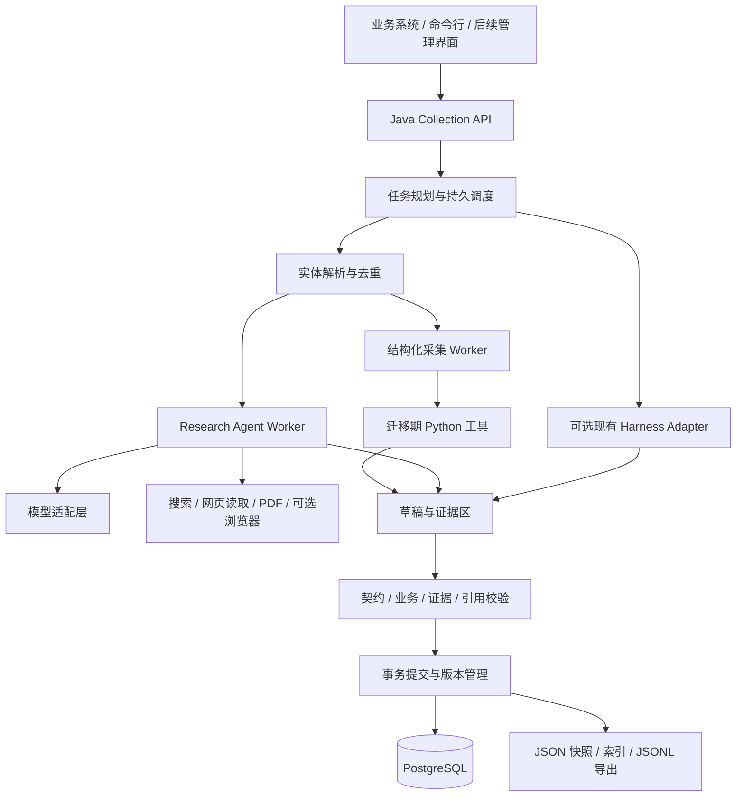

# 组织与人物采集 Java 工程化评估及实施方案

评估日期：2026-11-12。本文基于当前工作区中的技能、Schema 和 Python 脚本；属于方案设计，尚未实现 Java 服务，也未执行新的数据采集。

## 1. 评估结论与建议

**可行，建议建设“Java 任务编排与数据治理 + 受控 Research Agent + 可替换模型及工具 + 过渡期 Python Worker”的采集服务。**

同一套能力支持国家批量采集、指定组织采集、指定人物采集，以及后续按字段刷新。国家批次负责发现并分发实体任务；单组织、单人物可以直接启动，无需先完成国家扫描。现有 Codex、Claude Code、DeepSeek Harness 可继续用于开发、难例处理和迁移期执行，但服务应持有任务、数据和工具的控制权。

工程化可明显改善断点恢复、并发控制、复用、审计和集成能力。画像事实质量仍取决于身份消歧、来源覆盖和模型综合能力，不能仅凭更换语言或框架保证提高。尤其不能把“调用一次大模型返回 JSON”作为整个采集服务。

建议首先做 Spring Boot 模块化单体，使用 PostgreSQL 保存任务与实体数据，复用现有 Python 工具。第一版不强制引入微服务、Kafka、图数据库、向量库或完整工作流平台。

## 2. 当前仓库的真实基础

### 2.1 可复用的业务流程

以 `.agents/skills/country-org-collector/SKILL.md` 的五阶段流程为基线：

| 当前阶段 | 实际职责 | Java 服务中的对应能力 |
| --- | --- | --- |
| P1 广度扫描 | Agent 按国家和组织类别发现目标，输出 `_target_orgs.json` | DiscoveryTask，完成后创建组织子任务 |
| P2 缓存与骨架 | QID 验证、Wikidata/Wikipedia 缓存、组织骨架生成 | ResolveTarget / FetchStructured / BuildDraft |
| P3 组织丰富 | 每组织一个 Agent，当前最多 2 并行 | OrgResearchTask |
| P4 人物调查 | 从 key_people 生成人物清单，再逐人调查，当前串行 | DiscoverPeople + PersonResearchTask |
| P5 验证收尾 | 字段和关联校验、评分、名称索引及输出索引 | Validate / Commit / Export |

可复用的实际脚本位于 `.agents/skills/country-org-collector/scripts/`：

- `verify_qids.py`、`batch_collect.py`、`generate_profiles.py`：结构化采集与骨架生成。
- `update_person_list.py`、`resolve_ids.py`、`generate_name_index.py`：人物候选、名称匹配与引用解析。
- `validate_schema.py`、`generate_index.py`：现有业务校验、完整度评分和索引。
- `atomic_write.py`：UTF-8 JSON、单文件原子替换、名称处理与代理辅助。

组织与人物画像的 JSON Schema、枚举、中文/原文名称规范、来源要求及多语言搜索策略都可保留为业务资产。`scripts/export_people_lite.py` 等现有导出工具可作为后续兼容输出适配器。

### 2.2 工程化前必须澄清的现状

1. `docs/skill-architecture.md` 属于历史描述：其中部分阶段编号和脚本名与当前实现不一致。比如其列出的 `batch_person_profiles.py`、`resolve_person_qids.py` 未出现在当前技能脚本目录。不能按旧图假定这些能力已经可直接运行。
2. 当前 P4 通常依赖组织画像、人物清单和批次注册表，直接指定人物的独立入口需要新增。
3. `id_registry.json` 位于日期快照内，不能直接当作跨日期、跨任务的全局实体库；名字相同也不能直接认定为同一实体。
4. `atomic_write.py` 能防止单文件半写，但没有为注册表的“读—改—写”提供跨 Worker 互斥；两个文件依次替换也不构成数据库式事务。现有人物串行规则不能直接放开成多线程。
5. 规则存在漂移：主技能要求 key_people 有来源，但组织 Schema 的 key_person 字段白名单没有 source；组织规则手册允许未匹配 ID 写 null，而主技能对 related_entities 要求预注册；部分手册还包含固定国家和日期路径。
6. 日期规范同时出现“未知月日补 01”和“保留来源精度”的要求。内部数据应保存真实精度；旧格式的兼容必须单独决策，不能把补齐日期当作已证实事实。
7. 现有完整度评分按字段和条目数量加权，不能证明事实正确；不能将“85 分”作为对所有人物都强制成立的完成条件。
8. `.agents/skills/` 与 `.claude/skills/` 中的同名技能、Schema 和多份脚本已有差异。应选定唯一规则来源并版本化，不能让不同 Harness 各读一份漂移规则。
9. 当前搜索读取 MCP 配置依赖仓库外的本机 Python 服务路径。服务程序、网络权限和部署方式需显式确认，不能假定复制此仓库就能获得相同搜索能力。

这些是迁移事项，本文不直接修改现有数据或规则。

## 3. 三种采集入口与执行范围

| 入口 | 可接受的目标 | 默认执行范围 | 结果 |
| --- | --- | --- | --- |
| COUNTRY_COLLECTION | 国家/经济体、组织类别、数量上限 | 发现组织 → 组织画像 → 按配置发现并调查人物 → 汇总 | 批次、实体画像、关系、索引和报告 |
| ORGANIZATION_COLLECTION | 内部 ID、既有组织 ID、QID、官网或组织名称 | 身份解析 → 单组织画像；调查关键人物为显式选项 | 一个组织及受限的关联任务 |
| PERSON_COLLECTION | 内部 ID、既有人物 ID、QID、官方人物页或姓名 | 身份解析 → 单人物画像；关联组织仅建引用或待解析候选 | 一个人物及必要的关系引用 |

所有入口都包含身份解析、证据保存、校验和发布；跳过的是不必要的发现阶段。

### 指定目标时的规则

- 已验证内部 ID 可直接定位；既有 JSON ID 需同时提供数据集/快照上下文，避免历史 ID 歧义。
- QID、URL、姓名都是身份线索，不能未经实体类型与上下文检查就视为可信身份。
- 只有名字时，结合国家/活动地区、组织、职位、官网、别名和履历进行消歧。人物的活动地区不等于国籍。
- 唯一且充分匹配时继续；多个候选均合理时进入 `WAITING_INPUT`，返回候选及差异，允许调用方补充信息；不由模型随机选择。
- 名称索引必须返回候选集合，不能使用 name → 单 ID 覆盖同名人物；别名、音译和姓名片段仅用于召回，不能单独证明身份相同。
- 无 QID、无 Wikipedia 仍可根据官网和公开来源创建画像；QID 不是必填前置条件。
- 单人物无需先采集其所属组织。已核实组织可只建立实体引用，未知关系保留待解析状态。
- 关联扩展由 `includePeople`、`maxPeople`、`relationDepth`、`maxEntities` 等参数限制。单组织默认不自动调查全部人物，单人物默认不递归调查亲属或关联机构。

建议额外支持 `REFRESH` 模式，在确定实体后只更新选定字段，例如现任职位、领导班子、新闻事件。增量刷新和“从失败任务继续”是两种不同操作。

## 4. 推荐架构与边界



### 4.1 Java 负责确定性的系统行为

负责参数、权限、任务依赖、状态、取消与恢复、ID 分配、实体去重、版本、预算、限速、质量门禁和结果发布。模型不能自行分配正式 ID、修改正式注册表或直接覆盖生产画像。

建议模块：`collection-api`、`collection-domain`、`collection-orchestrator`、`research-runtime`、`source-connectors`、`profile-quality`、`profile-storage`、`legacy-adapters`。初期可以是一个 Maven 工程中的模块，不要求独立部署。

### 4.2 Agent 负责有边界的研究

固定业务流程内允许模型动态选择搜索词、语言、来源和补充字段。单实体的执行循环为：

```text
加载已确认身份、画像版本、规则和预算
→ 识别资料缺口
→ 搜索候选来源
→ 读取高价值页面并保存正文证据
→ 提取带证据的事实和关系候选
→ 检查冲突与缺口，必要时补充搜索
→ 生成画像草稿及事实—证据映射
→ 程序校验；必要时有限次数修复
→ 提交发布服务处理
```

设置最大模型轮次、搜索次数、页面数、token/费用预算和墙钟超时。到达预算后以明确原因结束或进入待复核，不因分数不足无限搜索。

每个已完成搜索/读取/提取步骤保存输入摘要、工具参数、结果引用、用量和错误。重启后从检查点接续；不依赖上一段聊天上下文，也无需保存模型私有思维过程。

### 4.3 工具由服务提供或显式接入

核心工具契约建议为 `searchWeb`、`fetchPage`、`fetchWikidata`、`fetchWikipedia`、`extractPdf`、`lookupEntity`、`submitDraft`。工具输出包含来源 URL、抓取时间、内容引用和结构化错误，而不只是大段文本。

搜索/读取可以使用现有可独立访问的 MCP 服务、商业搜索接口或模型厂商的独立工具 API。宿主内的 `WebSearch`、某个 MCP 工具名、本地浏览器会话和桌面登录状态，不能默认视为 Java 服务已有能力。

普通网页优先 HTTP 和正文抽取；需要 JS 时再使用隔离的浏览器 Worker，PDF 使用解析/OCR Worker。源站不可访问时记录原因并选择替代来源。工具网关对 URL/重定向、内网访问、资源上限和页面提示注入做约束。

## 5. 如何兼容 Codex、Claude、DeepSeek 等运行方式

必须分清两个接口：

| 接口 | 抽象对象 | 职责 |
| --- | --- | --- |
| ModelProvider | 模型推理服务 | 接收消息和工具定义，返回文本/工具请求/用量 |
| ResearchExecutor | 完整研究执行器 | 使用模型和工具完成一个有预算、有状态的研究任务 |

推荐以 `NativeJavaResearchExecutor` 作为服务长期主路径。它可切换模型供应商，但搜索、证据、状态和发布保持一致。不要让业务代码依赖特定宿主的工具名称。

迁移期可增加一个 `HarnessResearchExecutor`：Java 将任务、输入快照、规则版本和输出约定交给一个已验证可无人值守执行的 CLI/SDK/服务。执行器在独立目录工作，返回草稿、证据、日志和结构化状态，再经同一发布服务处理。

第一版只选择一个确有稳定机器接口的 Harness 做兼容试点，不同时承诺适配所有宿主。具体 Codex、Claude 或 DeepSeek Harness 的 headless 接口、认证、工具配置和恢复方式应实测后确定；桌面应用能交互运行不等于已具备服务器执行接口。

独立目录本身不是隔离边界，Harness/Python 进程还需受限文件挂载或进程权限、超时和进程树回收；通过参数数组启动，避免拼接 shell。正式数据目录不向研究进程开放写权限。

### 技术可行性核实

- Spring AI 提供 Java 工具调用能力；工具执行仍由应用控制。可用它封装模型调用，业务状态与发布不交给模型决定。[Spring AI Tool Calling](https://docs.spring.io/spring-ai/reference/api/tools.html)
- Spring AI 的通用结构化输出转换是尽力而为，不能替代独立 Schema 校验。原生约束输出也应按供应商能力启用。[Spring AI Output Converters](https://docs.spring.io/spring-ai/reference/api/structured-output/converters.html)
- DeepSeek 官方支持工具调用；JSON Output 需要处理空白内容和截断。能输出 JSON 不等于满足本仓库 Schema，也不等于事实可靠。[DeepSeek Tool Calls](https://api-docs.deepseek.com/guides/tool_calls/)、[DeepSeek JSON Output](https://api-docs.deepseek.com/guides/json_mode/)
- DeepSeek 目前另有独立 Search/Fetch API，可作为搜索/读取适配器候选；是否选用应按本项目多语言覆盖、正文质量和可用性实测。[DeepSeek Search & Fetch](https://api-docs.deepseek.com/guides/search/)
- Claude 官方区分直接模型 API 与完整 Agent SDK；其本地 Agent SDK 使用 Python/TypeScript，其他语言也可通过结构化 CLI 子进程接入同一执行循环，可作为 Java 迁移适配的一个具体候选。[Claude Agent SDK](https://code.claude.com/docs/en/agent-sdk/overview)
- Temporal 有 Java SDK，可用于后续较复杂的持久工作流。Workflow 代码需确定性，LLM、搜索、抓取和数据库 I/O 放在 Activity 中；引入它仍需对重试和提交设计幂等性。[Temporal Java SDK](https://docs.temporal.io/develop/java)、[Workflow 约束](https://docs.temporal.io/develop/java/workflows/basics)

供应商适配需有能力矩阵：工具调用、约束输出、流式事件、token 用量、重试语义、上下文与思考模式消息要求。协议兼容不代表能力一致；首期固定一个模型和工具组合建立基线，再替换比较。本文不预设某供应商一定更便宜或质量更高。

## 6. 任务模型、恢复与并发

### 6.1 Job 和 Task 分开

Job 表示用户提交的一次采集请求；Task 表示发现、解析、采集、丰富、验证、发布等可恢复步骤。国家 Job 产生多个组织/人物 Task，直接组织和人物 Job 复用相同执行单元。

Job 状态：`QUEUED / RUNNING / WAITING_INPUT / SUCCEEDED / PARTIAL / FAILED / CANCELLED`。

Task 状态：`PENDING / READY / RUNNING / RETRY_WAIT / WAITING_INPUT / SUCCEEDED / FAILED / SKIPPED / CANCELLED`。

无可靠来源、无搜索结果、身份不明、来源暂不可用、画像校验失败和系统故障分别记录原因。资料不足但保留合法结果可使 Job 为 `PARTIAL`；关键身份尚未确认时不得正式发布该实体画像。

### 6.2 初期使用 PostgreSQL 持久任务表

通过事务领取、任务租约、心跳、`next_attempt_at` 和过期回收调度；不能只用 `@Async` 或内存队列。任务依赖保存在数据库中，父任务不会因某个子任务失败就丢失其他已完成结果。

同一实体同一研究配置的活动任务合并或串行。`entity_id` 明确前的任务先按目标指纹去重，解析后再次按规范实体合并。

Worker 被回收或取消后，租约版本/执行令牌失效；发布服务拒绝旧 Worker 的迟到提交。画像用版本号做乐观锁，避免旧研究覆盖新修改。

### 6.3 接受至少一次执行，保证提交幂等

HTTP 超时或进程中断可能导致同一工具请求再次执行，不能承诺端到端 exactly-once。对发布使用唯一的提交键，数据库事务中同时更新画像版本、关系、任务状态和导出事件。导出从已提交版本构建，可安全重试。

创建请求支持 `Idempotency-Key`；重复提交相同请求返回已有 Job，相同键对应不同请求则拒绝。明确的刷新请求有新的运行标识，不被永久去重挡住。

### 6.4 并发从保守配置开始

兼容旧文件脚本阶段保留组织并行 2、人物串行以及批次注册表单写者。迁移为数据库集中分配 ID 和提交关系后，再逐步放开不同人物的并行研究。

采集并发与数据源配额分开控制。按供应商账号、数据源/域名设置共享限速器，不能由每个 Worker 各自认为自己未超限。现有技能中的频率作为保守初值，正式值按供应商约束和项目网络实测配置。

若后续出现多日等待、复杂分支、大量跨 Worker 子流程或数据库调度维护负担，再将编排迁至 Temporal；业务 Task 与执行器接口保持独立，不自建通用 BPMN 平台。

## 7. 实体、证据、版本与旧格式兼容

### 7.1 最小数据表

| 表/逻辑集合 | 作用 |
| --- | --- |
| collection_job / collection_task / task_attempt | 请求、依赖、租约、尝试、错误、预算 |
| entity / entity_alias / entity_external_ref | 规范身份、名称别名、经核验的 QID/官网等 |
| legacy_id_mapping | 历史数据集、日期快照、旧 ID 到规范实体的映射 |
| profile_version / relationship | 画像历史与带有效时间的实体关系 |
| source_document / claim / claim_evidence | 抓取内容、事实候选和证据绑定 |
| tool_call / usage_record / export_event | 工具轨迹、用量、导出事件 |

### 7.2 内部 ID 与历史 ID 分开

内部使用不受国家、类别和快照变化影响的 `entity_id`。保留 `SG-GOV-001`、`SG-PERSON-000001` 等历史业务 ID，通过含数据集与快照上下文的映射使用；选择一个既有批次作为兼容基线时，保留其已发布 ID。

跨日期导入遇到同一旧 ID 指向不同身份、多个旧 ID 对应同一 QID 等情况，先产生冲突报告，不能按编号或姓名批量合并。QID 绑定也必须经过本人/本组织验证后才纳入唯一外部标识约束。现有脚本的 counter 键结构亦有差异，导入时按实际已占用 ID 校正，不能直接相信某一份计数器。

批次国家、人物国籍、任职组织国家和总部所在地分别建模。对相关组织只有足够身份信息时才创建规范实体，否则保留待解析候选。单人物任务不因缺少相关组织完整画像而被迫展开全链条采集。

### 7.3 证据独立存储

每个被采纳事实绑定来源、抓取时间、页面/文档内容摘要或对象引用、证据片段、有效时间及核验状态。来源 URL 可追溯只是第一步，还需确认片段支持该事实且主语是目标实体。

证据使用稳定的 claim_id 关联，JSON Pointer 仅在一个确定画像版本内定位字段，避免数组重排后证据指向错误条目。转载同一官方公告的多个网页不能算多个独立来源。

现有 Schema 大量采用 `additionalProperties: false`，第一版不向旧 JSON 随意加入 evidence 等字段。内部证据存在数据库，文件导出需要时存放独立 sidecar；旧画像继续通过既有格式导出。无法可靠回填的历史证据明确标记，不伪造完整证据链。

### 7.4 日期、职位和刷新

日期内部记录值和 `YEAR / MONTH / DAY` 精度；职位与关系记录有效时间和观测时间。刷新时生成新版本及差异，不覆盖历史任职信息，也不把“本次未搜到”解释为“已离任”或“原事实不存在”。

旧 Schema 要求完整日期而来源只有年份时，仅对允许 null 的字段留空，并在 sidecar 保留已知年份。对于不接受 null 的必填字段，例如组织 recent_events[].date，该事实保留在内部 claim/sidecar，从旧格式数组中省略该条目，并报告导出损失；不能产生不符合 Schema 的占位条目。原本允许年/月精度的字段按其真实精度导出。历史补齐数据保留其兼容状态，未来扩展 Schema 时明确版本，不会新增虚构的 1 月 1 日事实。

## 8. 质量门禁与规则迁移

### 四层门禁

1. **结构**：真实执行 JSON Schema 校验，随后执行现有业务校验；检查编码、枚举、字段、ID、日期和必填约束。
2. **身份与引用**：QID 类型、名称/别名、组织/职位/时间线等互相一致；正式关系引用规范实体，不能引用不存在的正式实体。
3. **证据**：已采纳事实有可读取来源支持，重要职位/关系尽量按现有规则获得独立来源交叉验证；证据不足时标注待核实或留空，不为完成度补造信息。
4. **内容**：中文描述、目标国家华文译名、事实与分析区分、时间线冲突、现任/历史职位、来源时效性。

兼容模式保留原完整度算法用于对比，另外记录事实证据覆盖、身份确定状态、待核实事实、不可获得字段和来源时效性。评分由程序计算。不能强迫没有公开社交账号或教育资料的人物填满字段来达到 85 分。

单实体任务针对本次实体及其引用闭包做校验，不要求全国家画像先齐全。内部允许只有身份的被引用实体；旧格式导出若依赖严格的“必须存在完整文件”规则，需要选择自包含快照或先补齐依赖，无法兼容时明确拒绝该种导出，不能把悬空引用伪装为通过。

### RuleBundle

将现有技能整理为带版本的规则包：Schema、字段说明、枚举、来源/语言规范、搜索策略、消歧策略、评分与完成条件。核心契约以 Schema 和可执行规则为准，国家差异作为参数/配置，删除固定国家路径。

模型提示、Java 校验和 Python 兼容校验都绑定同一个 RuleBundle 版本。收敛冲突规则时形成明确变更记录，禁止运行时让不同 Agent 自行选择某份手册。

## 9. API 设计示例

以下是拟议接口和参数，不是现有可调用端点。枚举和预算值最终由实现固定。

### 国家批次

`POST /api/v1/collection-jobs`，请求头支持 `Idempotency-Key`。

```json
{
  "type": "COUNTRY_COLLECTION",
  "target": {"country": "SG"},
  "scope": {
    "orgTypes": ["GOV", "FIN"],
    "maxOrganizations": 20,
    "includePeople": true,
    "maxPeople": 50,
    "maxEntities": 100
  },
  "researchProfile": "standard",
  "executionProfile": "java-primary-v1",
  "exportFormat": "legacy-json"
}
```

`maxEntities` 包括新增的引用实体；触及上限时保留未解析候选，不通过创建无限占位实体绕过预算。

### 指定组织

```json
{
  "type": "ORGANIZATION_COLLECTION",
  "target": {
    "name": "示例组织名称",
    "countryHint": "SG",
    "officialUrl": "https://example.org"
  },
  "scope": {"includePeople": true, "maxPeople": 5, "relationDepth": 1},
  "researchProfile": "deep"
}
```

示例名称和域名是占位输入。`relationDepth=1` 只允许一次关联发现，不递归触发整个关系网。

### 指定人物

```json
{
  "type": "PERSON_COLLECTION",
  "target": {
    "name": "示例人物姓名",
    "countryHint": "SG",
    "organizationHint": "示例任职组织"
  },
  "scope": {"includeRelatedProfiles": false, "relationDepth": 0},
  "researchProfile": "deep"
}
```

也可用经过解析的 `entityId` 或 QID 定位；输入多个标识不一致时进入冲突处理。

其他接口建议：查询 Job、分页查询 Task、读取任务事件、提交身份选择、重试指定失败 Task、取消 Job、读取实体版本与证据、创建字段刷新任务、申请兼容导出。创建返回 `202 + jobId + statusUrl`，通过查询或 SSE 读取进度，不让一次 HTTP 请求阻塞整个采集过程。

## 10. Python 复用与部署路径

### 过渡期

Java Worker 将输入快照复制到任务独立工作目录，通过固定命令与参数调用经过审计的 Python 脚本。对仍写注册表、索引的旧脚本按批次加锁；输出只能进入草稿区，不覆盖正式数据。

包装层需返回结构化结果，包括退出码、输入/输出文件摘要、校验报告、日志引用和是否有可恢复结果。不能仅凭 exit code 或文件存在认定采集完成：例如当前批量缓存脚本可能在部分条目失败后仍结束正常，已有画像的跳过逻辑也不能直接用于刷新。缓存需检查完整性、来源时间、输入指纹和刷新策略。现有脚本有路径/参数兼容差异，逐个建立 wrapper，不把任意命令执行暴露给模型。

`validate_schema.py` 的业务规则保留为迁移基准；Java 端独立执行真正的 JSON Schema 校验。人物研究仍需实现 Agent 执行器，不能由缺失的历史人物脚本替代。

### 部署与后续迁移

初期部署一套 Java API/Worker、PostgreSQL、Python 环境，以及可访问的搜索/读取服务。原始文档和导出文件先用受管本地存储，接口保持可替换为 S3 兼容对象存储。浏览器、OCR 按需独立 Worker。

配置管理 API 密钥、代理和网络路由；不要把本机固定代理、私网地址或桌面凭据写死在业务代码。日志统一关联 job_id/task_id/entity_id，记录调用用量、失败原因、队列等待和实际研究耗时。

逐步将热点结构化采集、ID 与索引迁入 Java；Python 保留在 PDF/OCR 等确有收益的组件。Java 工程化不要求第一版消除所有 Python。

## 11. 实施顺序、验收与投入估计

以下按 2 名熟悉 Java/采集的工程师、可用数据库和模型/搜索接口、无复杂前端的前提粗估；不是基于现有吞吐测试的工期承诺。

| 阶段 | 预估 | 交付与退出条件 |
| --- | --- | --- |
| A 基线与契约 | 第 1 周 | 选定样本、审计脚本、消除核心规则冲突、确定 ID/证据/日期兼容策略，验证一种模型+工具组合 |
| B 单实体闭环 | 第 2–3 周 | 单组织与单人物 API、受控 Agent、证据保存、校验和版本发布；人物可不依赖既有组织档案执行 |
| C 批次与可靠性 | 第 4–5 周 | 国家发现与 fan-out、限速预算、失败重试、崩溃恢复、ID/引用并发控制、兼容导出 |
| D 对比试点 | 第 6 周附近 | 与当前 Harness 流程对比，验证质量、成本、耗时、难例回退，决定正式默认执行器 |

MVP 约 4–6 周量级；若要求一期实现所有 Harness 适配、完整管理界面、全量历史数据治理或高可用部署，需要另行增加范围与投入。生产化时间在试点后重估。

### 建议验收样本与指标

先选约 10 个组织、20 个人物，覆盖有/无 QID、同名、非英文官网、跨组织任职、跨国籍、来源少、来源冲突和已有快照更新；使用固定输入与规则版本，记录采集时点。

- 三种入口均可用；单人物无需先跑国家任务，单组织的关联人数限制生效。
- 发布结果全部通过目标 Schema 与业务门禁，旧 JSON/索引和现有导出链路可用。
- 抽样核验关键事实与证据一致，验收集未发现错人错组织；这不代表能保证未来所有事实零错误。
- 杀进程、租约过期、重复请求、两任务研究同一人、迟到提交等故障场景不产生重复实体和已发布版本回退。
- 无资料、预算耗尽和来源失败能给出可解释状态，不进入无限循环。
- 记录每实体耗时分布、模型输入输出 token、搜索/读取次数、重试、人工复核量，与现有流程比较后再定生产门槛。

总成本按模型调用、搜索/抓取、浏览器/OCR、存储/Worker 与人工复核计；不能只比较 token 单价。缓存和实体复用可减少重复采集，但收益需要实测。

## 12. 首期范围与下一步

首期优先做两条纵向闭环：**指定组织 → 画像/证据/发布**、**指定人物 → 画像/证据/发布**；跑通后把国家流程变为这些单实体任务的批量编排。这样最早验证当前宿主中的研究能力能否迁移，同时直接覆盖新增使用场景。

首期必须包含任务持久化、身份消歧、受控研究循环、集中 ID、证据与版本、质量门禁、旧格式导出、取消/恢复和调用预算。现有 Harness 的兼容只选择一个试点执行器；新增供应商和复杂浏览器场景按样本收益逐步引入。

本方案最先需要验证的技术问题是：在相同来源工具与预算下，Java 执行器能否达到当前 Harness 流程的事实质量。若暂未达到，仍可用 Java 管理生产任务，由已验证 Harness 执行研究；数据治理和执行接口无需推倒重来。
